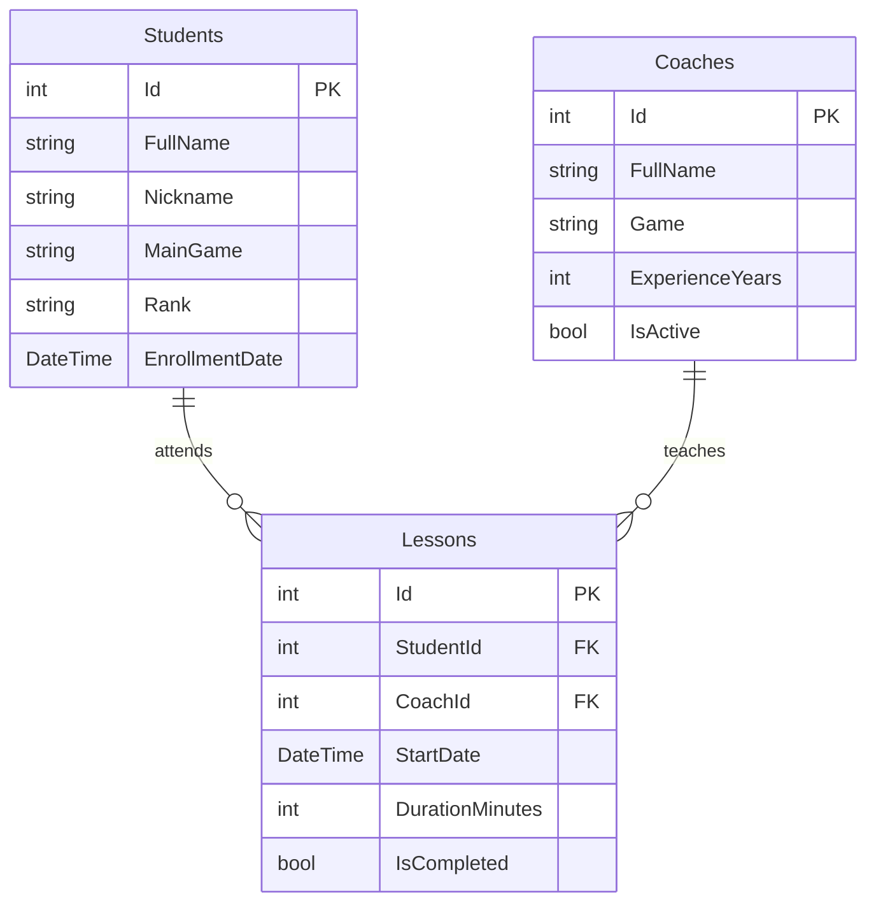

# CyberBoost
Приложение для учёта учеников, тренеров и занятий в школе киберспорта по разным дисциплинам, таким как CS2, Valorant и Dota 2.

## Автор
- Фамилия, имя: **Мустафаев Кирилл**
- Группа: **9/3-РПО-24/1**

## О проекте
Тема - школа киберспорта **CyberBoost**. В нашей престижной школе киберспорта ученики занимаются с тренерами по CS2, Valorant и Dota 2. Приложение нужно администратору школы, чтобы хранить информацию об учениках и тренерах, а также составлять расписание занятий. Наша главная особенность - у нас лучшие индивидуальные тренировки с учётом игры и уровня подготовки ученика, а также персональные тренеры которые имеют огромный опыт за плечами.

## Схема базы данных

## Таблицы
### Students - ученики
Хранит информацию об учениках школы киберспорта

| Поле | Тип | Обязательное | Описание |
|---|---|---|---|
| Id | int | Да | Уникальный номер ученика, первичный ключ |
| FullName | string | Да | Имя и фамилия ученика |
| Nickname | string | Нет | Игровой никнейм |
| MainGame | string | Да | Основная игра ученика |
| Rank | string | Нет | Текущий игровой ранг |
| EnrollmentDate | DateTime | Да | Дата записи в школу |

### Coaches - тренеры
Хранит сведения о тренерах которые проводят занятия

| Поле | Тип | Обязательное | Описание |
|---|---|---|---|
| Id | int | Да | Уникальный номер тренера, первичный ключ |
| FullName | string | Да | Имя и фамилия тренера |
| Game | string | Да | Игра, по которой тренер проводит занятия |
| ExperienceYears | int | Да | Опыт тренерской работы в годах |
| IsActive | bool | Да | Работает ли тренер в школе сейчас |

### Lessons - занятия
Хранит сведения о занятиях и о том какой ученик с каким тренером занимается

| Поле | Тип | Обязательное | Описание |
|---|---|---|---|
| Id | int | Да | Уникальный номер занятия, первичный ключ |
| StudentId | int | Да | Внешний ключ на Students.Id |
| CoachId | int | Да | Внешний ключ на Coaches.Id |
| StartDate | DateTime | Да | Дата и время занятия |
| DurationMinutes | int | Да | Продолжительность занятия в минутах |
| IsCompleted | bool | Да | Проведено ли занятие |

## Связи
Один ученик может посещать много занятий, но каждое занятие относится только к одному ученику. Один тренер может проводить много занятий, но у каждого занятия только один тренер. Таблица `Lessons` связывает `Students` и `Coaches` через обязательные внешние ключи `StudentId` и `CoachId`, поэтому между учениками и тренерами получается связь многие ко многим, т.е ученик может заниматься с разными тренерами, а тренер обучать разных учеников.